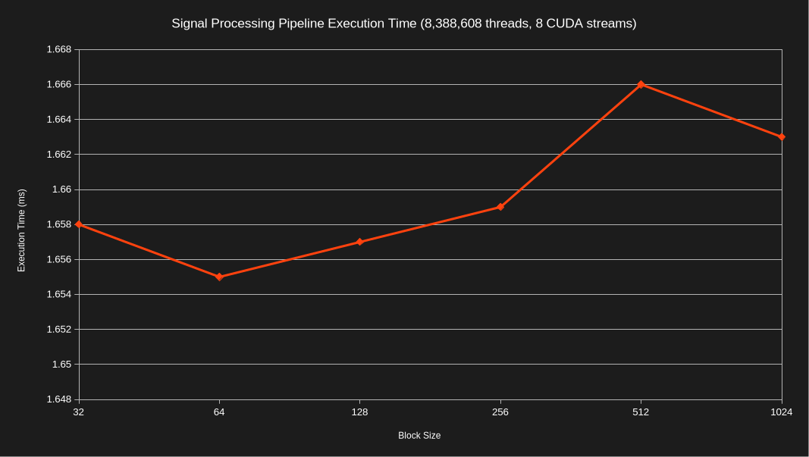
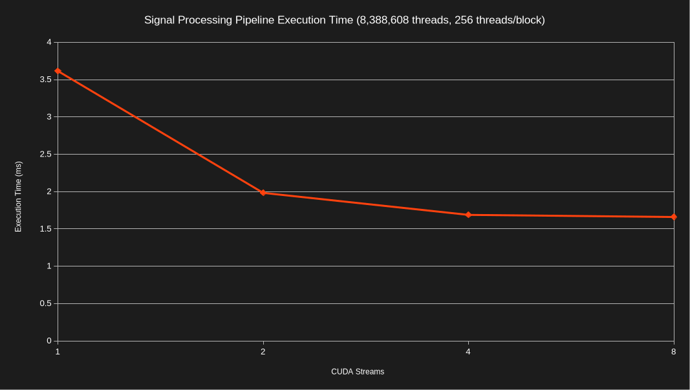
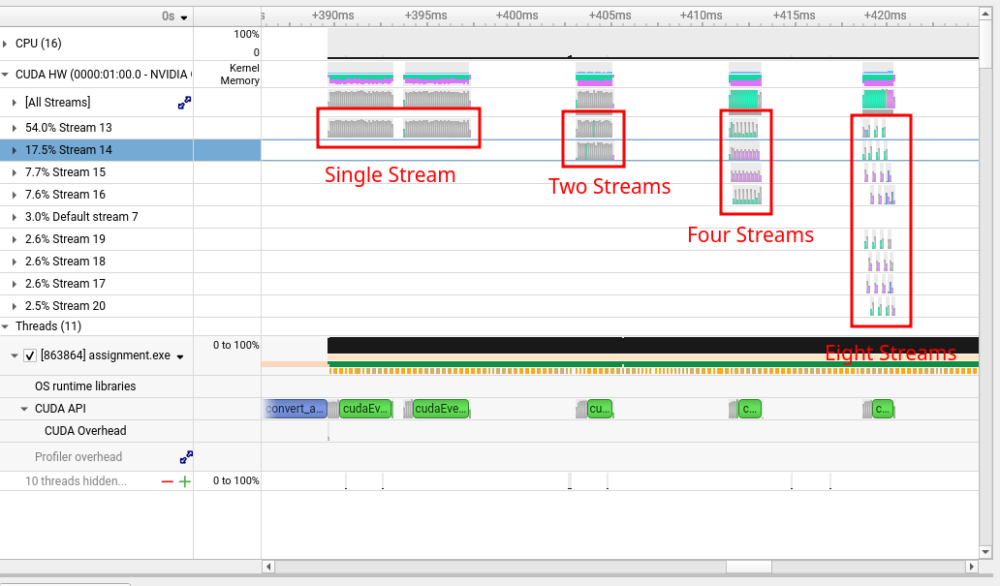
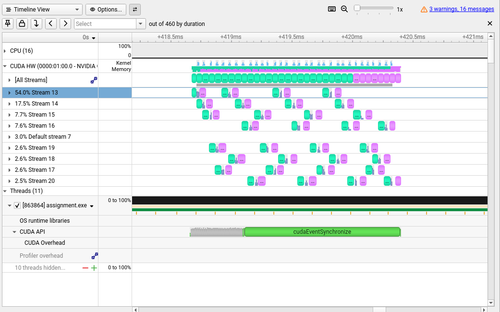
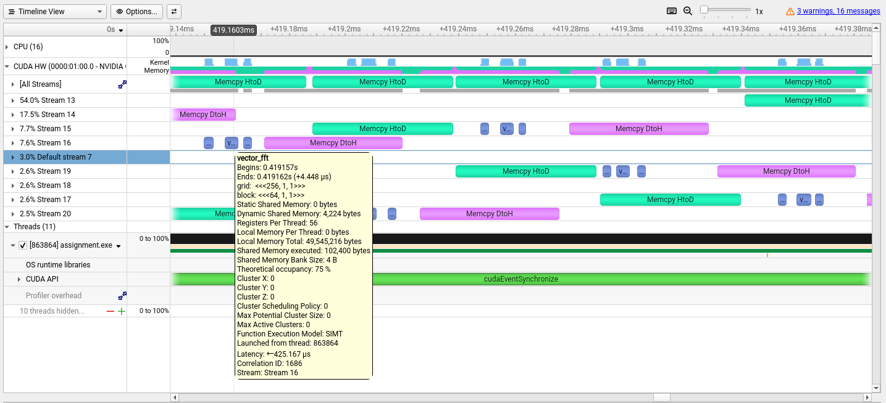

# Module 6 Assignment

The following directory contains the source code for Module 6. The source code
implements kernels and functions that perform the following operations:

1. Generate a complex int16 radio frequency signal with a constant amplitude
   tone in a specific frequency bin

1. Scale the int16 signal to floating point

1. Apply a Hann windowing function to taper the ends of the signal to 0

1. Run the signal through a complex-to-complex forward FFT

1. Convert the magnitude of each frequency bin in the output FFT to decibels
   (dB)

1. Validate that the generated signal appears in the expected frequency bin

The program makes usage of CUDA streams and events to chunk the input signal
across multiple CUDA streams. The host to device and device to host memory
transfers are performed asynchronously by each stream and the kernels are
launched in parallel. CUDA events are used to measure the elapsed execution time
across all streams (including memory transfers) and to signal when each stream
has finished executing.

## Test Harness

The `execute_gpu_functions()` function in the source code tests the code across
a variable number of CUDA streams and measures the speedup. The assignment
required at least 2 separate runs of each part of the program. For the tested
thread counts, it executes between 3 and 4 times. It initially executes the
signal processing pipeline with 1 CUDA stream and continues to multiply the
streams by 2 until it reaches the configured maxmimum of 8. The program outputs
a table with the total execution time of the pipeline based on the stream count.
For example:

```
------------------------------------------------------
 Streams  Time (ms)  Speedup
       1      3.621    1.00x
       2      1.947    1.86x
       4      1.692    2.14x
       8      1.657    2.18x
------------------------------------------------------
```

This table shows that executing with 4 streams provided a 2.14x speedup versus
executing with 1 CUDA stream.

The [assignment_config.yaml](../assignment_config.yaml) also acts as a test
harness as it exercises the program across a variety of different thread counts
and block sizes. For this program, the total thread count is equal to the length
of the generated signal (in samples). For example, executing the program with
8,388,608 threads generates a test signal with 8,388,608 complex int16 samples.
Each complex sample is 4 bytes in size (2 bytes for I and 2 bytes for Q).

## Build and Run

The code is intended to be automatically built and run using the assignment
runner. This can be accomplished by executing the following commands:

```bash
git clone https://github.com/mattgermano/EN605.617.git
cd EN605.617
./assignment_build_execution/run_assignments.sh
```

The above command requires Python 3,
[uv](https://docs.astral.sh/uv/getting-started/installation/), CMake, CUDA/NVCC,
and g++. These dependencies can be installed on Ubuntu 26.04 using the following
commands:

```bash
sudo apt update && sudo apt install -y wget build-essential cmake python3 git
wget https://developer.download.nvidia.com/compute/cuda/repos/ubuntu2604/x86_64/cuda-keyring_1.1-1_all.deb
sudo dpkg -i cuda-keyring_1.1-1_all.deb
sudo apt update
sudo apt install -y cuda-toolkit-13-4
wget -qO- https://astral.sh/uv/install.sh | sh
source $HOME/.local/bin/env
```

Also, ensure that `nvcc` is on your `PATH` via the following command:

```bash
export PATH="/usr/local/cuda/bin:$PATH"
```

The assignment runner executes the [`build.sh`](./build.sh) and
[`run.sh`](./run.sh) scripts to build and run the project with different
configurations.

Alternatively, the code can be manually built using the following commands:

```bash
cd module6
cmake -S . -B build -D CMAKE_BUILD_TYPE="Release"
cmake --build build --parallel $(nproc --ignore=1)
```

If CMake isn't available, you can also run a simple `make` command from this
directory:

```bash
make
```

It can then be run as follows:

```bash
./build/assignment.exe <total_threads> <block_size>

# ...for example
./build/assignment.exe 4194304 256
```

## Performance Comparison

The following graph shows the complete execution time (including memory
transfers) for the signal processing pipeline across different block sizes with
8,388,608 total threads. There are very small variations between runs and the
execution time is largely consistent across different block sizes.



The more interesting thing to analyze for this program is the difference in
execution time with different numbers of CUDA streams. The following graph shows
the complete execution time across different CUDA stream counts.



The largest speedup occurs when moving from 1 to 2 CUDA streams with a slightly
marginal speedup going from 2 to 8. When multiple CUDA streams are used, the
generated signal data is chunked and can be processed in parallel across
different streams. CUDA events are then used to synchronize all streams after
they have finished execution.

The easiest way I found to visualize this was by profiling the application with
Nsight Systems. The following image shows the CUDA operations performed across
the execution of the program. As a reminder, the program runs the pipeline with
a single stream and then multiplies by 2 until reaching the max stream count of
8. The call graph shows the overlapping execution of multiple CUDA streams.



Zooming in on the run with 8 CUDA streams shows how certain operations can
overlap and reduce the execution time of the program.



For example, while Stream 19 was performing a host to device memory transfer,
Stream 20 was simultaneously performing a device to host memory transfer.
Additionally, the FFT kernel in Stream 16 was executing while Stream 20 was
performing a memory transfer.


